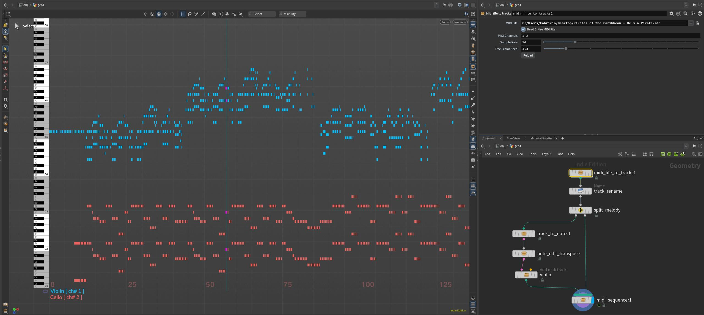
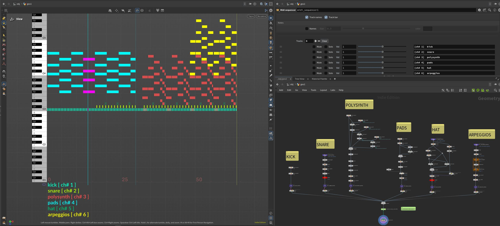

# Houdini MIDI Sequencer plugin

A simple sequencer that allows for procedural music experimentations within sidefx houdini.

Check the [wiki](./wiki) page for more info, or [plugin](./plugin) page for install instructions.

## Features
- Arbitrary number of tracks (midi channels)
- Notes are simple curves, use any SOP to add/modify them
- Note edits: snap, scale, loop, transpose, swing groups of notes
- Chords: preset scales, custom scales, arpeggios
- Note dynamics: Draw velocity and pitch directly over notes [WORK IN PROGRESS]
- Master controls: per track mute/solo/volume
- Midi file importer: .midi or .mid file to sequencer notes

...more to come.

