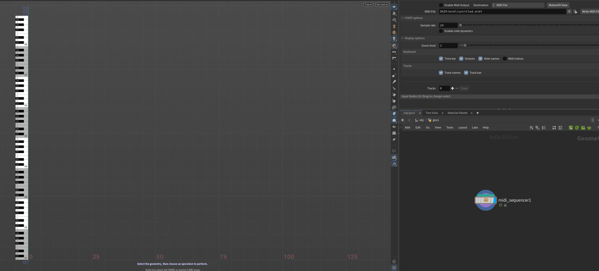
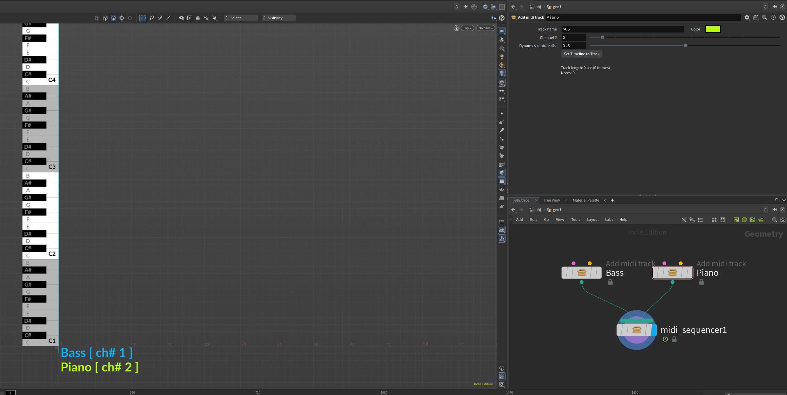
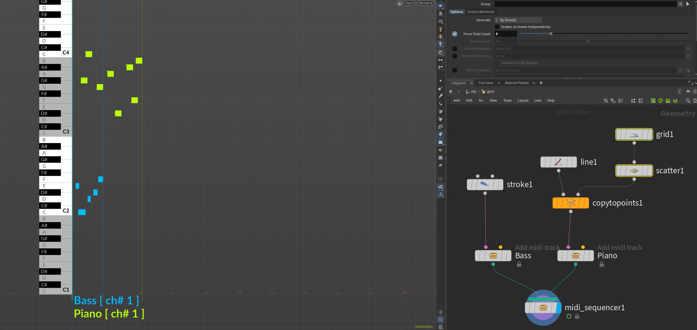
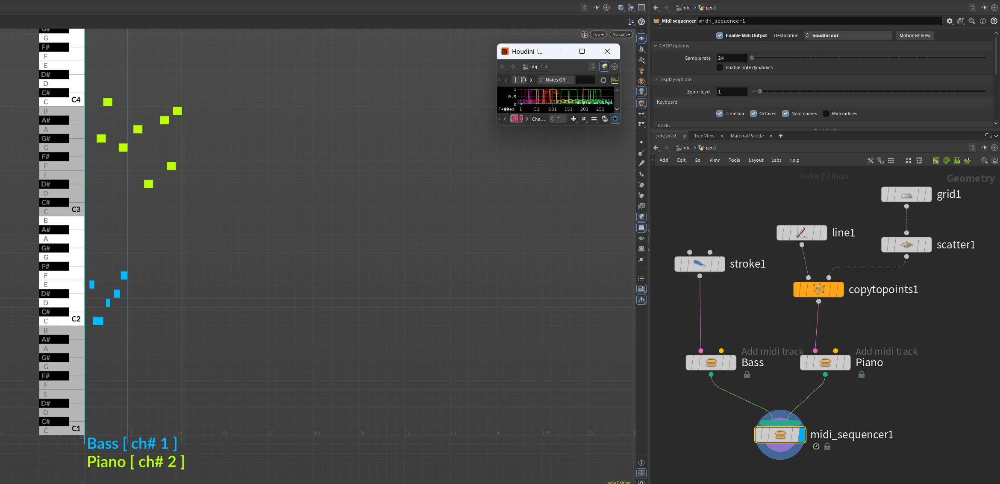

Index:

[1 - Before you start](#before-you-start) 
[2 - Wiring it all together](#wiring-it-all-together) 
[3 - Houdini workflow](#in-houdini) 
[4 - Play it!](#play-it) 
[5 - Going forward](#going-forward) 
[6 - Node list](#node-list) 

## Before you start:

When creating procedural music, you just want to hear stuff live. To avoid having to write .midi files every time, its advisable that you open MIDI ports on your machine and send live signals to a synthesizer that keeps listening to houdini notes. 

Because midi is an old protocol it requires some setup to get you started. Below are some tools and information that might help.

### LoopMIDI

[LoopMIDI](https://www.tobias-erichsen.de/software/loopmidi.html) is an app that creates virtual midi cables on your machine. When you create a port in LoopMIDI it will show up in the houdini sequencer hda.

### Mididash

[Mididash](https://tiagolr.github.io/mididash/) is an app that acts as a midi router, where you can split midi channels into different output ports. It is not required for the houdini sequencer to work, but its nice to be able use different instruments (synth instances) playing different tracks of your sequencer. (it has a nodal interface, just like houdini!)

### Synthetizers

A synthesizer is an electronic musical instrument, it can receive midi signals and play notes. There are many, paid and free ones. I'll list some free ones, I like to use SurgeXT.

[SurgeXT](https://surge-synthesizer.github.io/)  

[Vital](https://vital.audio/)  

[Dexed](https://asb2m10.github.io/dexed/)

You'll also need to setup your synth to receive and play the right midi port. We'll see how to do that in the next steps.

## Wiring it all together

Now that you downloaded the utility apps and a synth, here's the basics on how to setup up everything so you can start creating music in houdini:

### Create some ports in LoopMIDI:

`houdini out` is what houdini will be writing to.  
mididash gets `houdini out`, extracts ch1 and reroutes to `md out ch1`  
mididash gets `houdini out`, extracts ch2 and reroutes to `md out ch2`

we'll create these relationships in the next step. For now just create the ports with the same names as mine.

### Create routes in Mididash:

This is super simple and should look familiar to any houdini user! Just grab `houdini out` as a port input, wire into a "split" operator, and send each channel to its respective `md out ch` ports. Those are the ports that will be your inputs on the synth instances, see next step.

### Setup Synth inputs and instruments:

Open an instance of SurgeXT, click options > Audio/MIDI settings. Adjust the midi input to only listen to `md out ch1`, choose your instrument and done! Open another instance of SurgeXT, do the same for `md out ch2`. Keep both synth apps opened, and launch Houdini.

## In Houdini

### Plugin concepts

This plugin is still in development, but here are some basic concepts. At first it might seem weird because we will start building nodes bottom up, but it will make more sense later on.

Start with a `Midi Sequencer` node. It will display an 8 octave piano keyboard on your screen. The plugin is meant to be used in the top view, as if you were looking downwards into it, so switch to top view by pressing "space bar + 2". (switching background color to dark grey or black also helps!)

A sequencer accepts any number of tracks. Let's add two tracks: Bass and Piano, with two `add_midi_track` nodes. Make sure to set Channel# 1 for Bass and Channel# 2 for Piano. (each track also gets a random color upon node creation, make sure to give them some good contrasty colors!)

### Adding notes

See the color coding on the input ports? Anything magenta is a note (or group of notes), it accepts simple curve primitives. Here lies the power of proceduralism, use any sop to build those curves.

  
*if you are drawing notes using a stroke node, make sure to set projection to ZX plane. (remeber the plugin always assumes a top view!)*

Transform and edit nodes are also fine, abuse them for a more manual control over each note after they have been placed.

### Play it!

Time to hear your amazingly-better-than-Mozart musical piece. Check "Enable Midi Output" in the sequencer node, also change its destination port to `houdini out`. Definitely set your playback speed to realtime (the little toogle below play button, in the timeline)

Still not playing? That's because CHOP has some aggressive optimizations, it won't compute anything unless you have a motionfx window opened. Tsc Tsc. 
There is a convenience button "MotionFX view", right after the destination port, click it. 

There you go, if you set up everything correctly, you should hear your bass and your piano notes playing together, as different instruments, each on its own synth app instance.

### Going forward

Resist to the temptation of drawing notes while playing... yeah, I know. But this is not a DAW software, it is a houdini hack! But hey, scattering notes is cool heh? so give it a chance.

Another pain point is that even if not playing, just leaving the motionfx window opened while creating notes is heavy! I'm working on that, but for now just close the window, update, open the window, play. (sorry)

Now that you know the basics, check [example](../examples) hip files to see other use cases, workflows, node types and tricks. Hope it is fun! :musical_note::blue_heart:

---

### Node list:

-  **midi sequencer**: The heart of the system. Responsible for gathering a collection of tracks and sending out midi signals.
-  **add midi track**: creates a named track at specified channel number, with a random color.
-  **add notes**: a simple alternative for quickly adding notes (as opposed to drawing curve prims), where you just type in note names. (syntax: note names/accidents, and "+" or "-" signs for octave shifts, followed by one or more spaces in between each note. Example: `D# F   Bb-  C G A#+`)
-  **set notes**: redefine notes using written notation (or reference notes, if using the second input). Useful for repositioning notes without having to deal with transform values.
-  **note edit**: a unified toolbox for editing notes. Add snapping, scale or loop groups of notes, add swing, transpose by keys and octaves.
-  **note dynamics** (WIP): define per note midi velocity or pitch, by drawing curves over notes.
-  **note chord**: adds chords to input notes. Choose between common scale presets (or define your own scale), add/remove degrees to the chord (like 7th, 9th, 13th) or arpeggiate notes.
-  **midi file to tracks**: converts a midi file into sequencer tracks.
- **track to notes**: converts a track (packed geo) back into notes (simple curve geos) for further editings.
-  **rhythm**: record a pulse rythm by tapping a keyboard key.
-  **deintersect notes**: remove same-key note intersections. Two intersecting notes will prevent a correct midi signal to be sent, this hda corrects it and optionally adds a gap between the deintersected notes.
-  **chord progression**: creates a chord progression for the input notes. It can use a prim attribute to drive chord changes, or if left blank it will change chords for every input note.
-  **append notes**: utility hda to sequence groups of notes one after another.