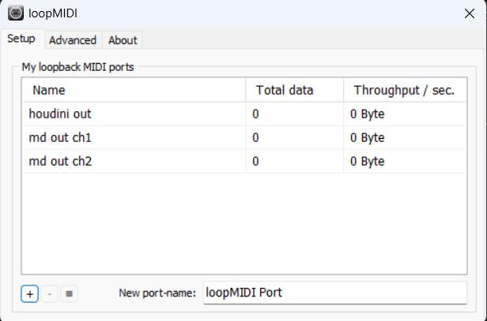
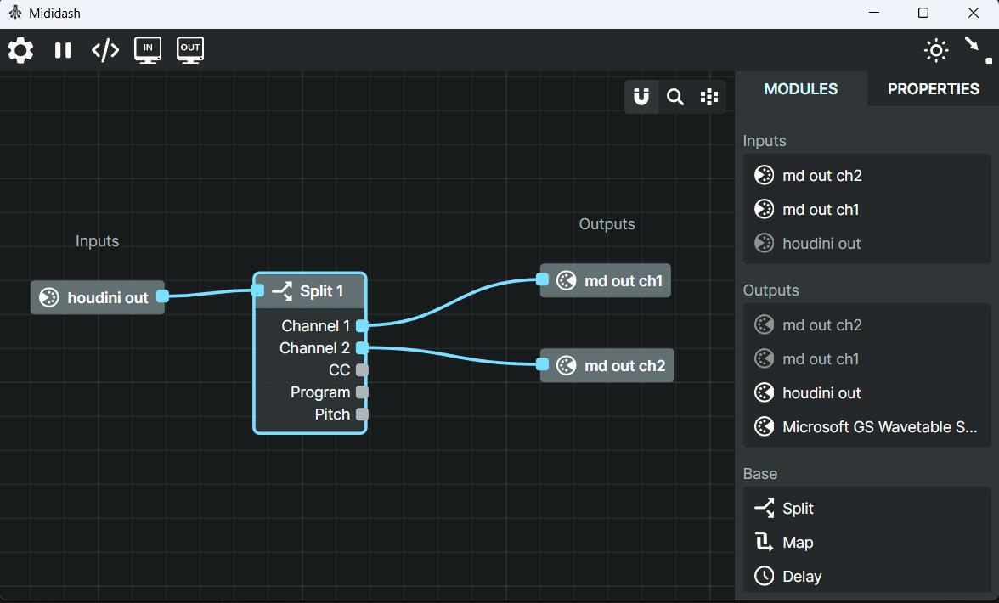
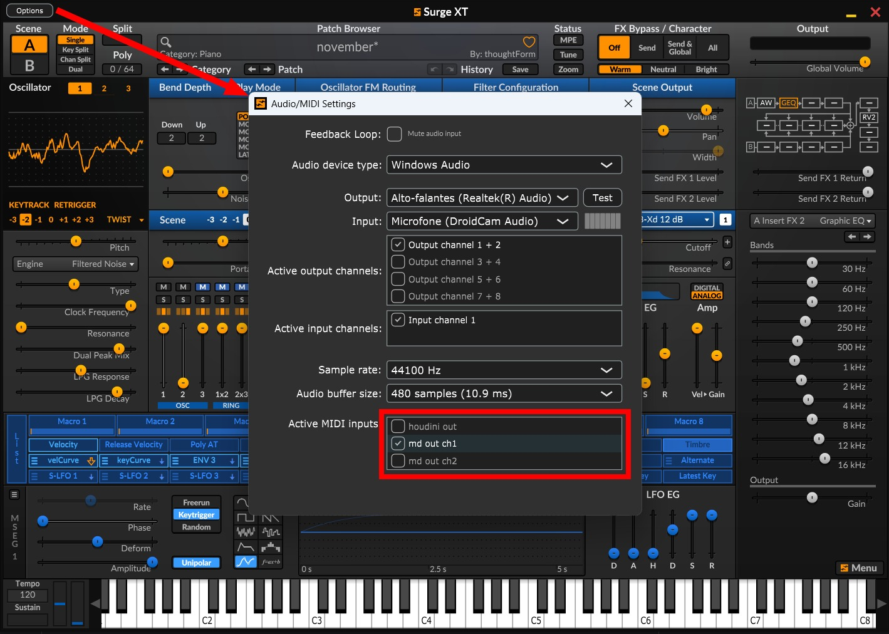

## Before you start:

When creating procedural music, you just want to hear stuff live. To avoid having to write .midi files every time, its advisable that you open MIDI ports on your machine and send live signals to a synthesizer that keeps listening to houdini notes. 

Because midi is an old protocol it requires some setup to get you started. Below are some tools and information that might help.

### LoopMIDI

[LoopMIDI](https://www.tobias-erichsen.de/software/loopmidi.html) is an app that creates virtual midi cables on your machine. When you create a port, it will show up as a destination in houdini.

### Mididash

[Mididash](https://tiagolr.github.io/mididash/) is an app that acts as a midi router, where you can split midi channels into different output ports. It is not required for the houdini sequencer to work, but its nice to be able use different instruments (synth instances) playing different tracks of your sequencer. (it has a nodal interface, just like houdini!)

### Synthetizers

A synthesizer is an electronic musical instrument, it can receive midi signals and play notes. There are many, paid and free ones. I'll list some free ones, I like to use SurgeXT.

[SurgeXT](https://surge-synthesizer.github.io/)  

[Vital](https://vital.audio/)  

[Dexed](https://asb2m10.github.io/dexed/)

You'll also need to setup your synth to receive and play the right midi port. We'll see how to do that in the next steps.

## Wiring it all together

Now that you downloaded the utility apps and a synth, here's the basics on how to setup up everything so you can start creating music in houdini:

### Create some ports in LoopMIDI:

`houdini out` is what houdini will be writing to.  
mididash gets `houdini out`, extracts ch1 and reroutes to `md out ch1`  
mididash gets `houdini out`, extracts ch2 and reroutes to `md out ch2`

we'll create these relationships in the next step.

### Create routes in Mididash:

This is super simple and should look familiar to any houdini user! Just grab `houdini out` as a port input, wire into a "split" operator, and send each channel to its respective `md out ch` ports. Those are the ports that will be your inputs on the synth instances, see next step.

### Setup Synth inputs and instruments:

Open an instance of SurgeXT, click options > Audio/MIDI settings. Adjust the midi input to only listen to `md out ch1`, choose your instrument and done! Open another instance of SurgeXT, do the same for `md out ch2`. Keep both synth apps opened, and launch Houdini.

